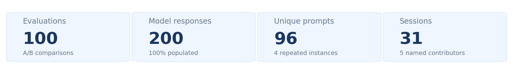
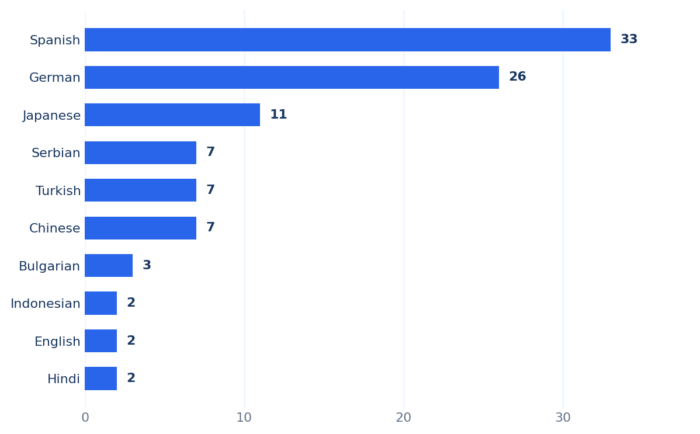
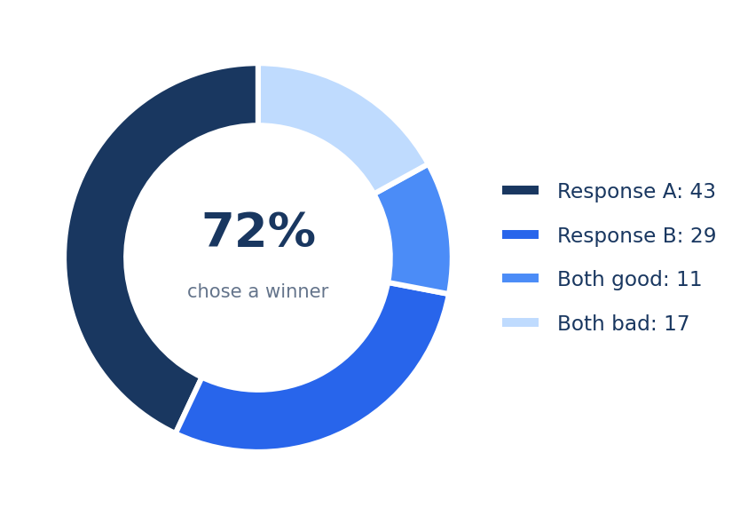
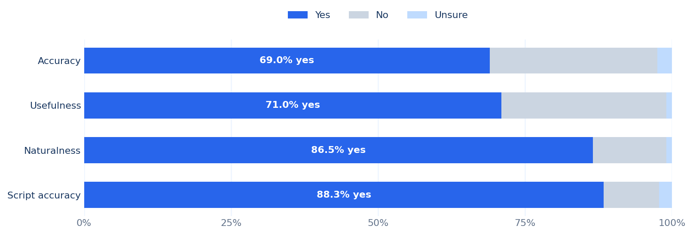
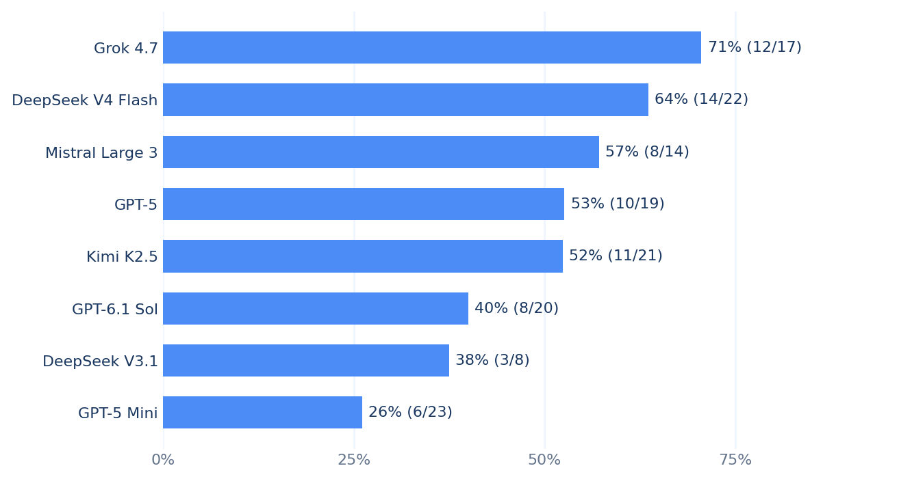

# Polyglot Battlemode I

*Community-led multilingual LLM evaluation, November 2026*

Polyglot Battlemode invites people to compare two AI-generated responses to prompts in their languages and evaluate their quality. This first collection comprises **100 human A/B comparisons**, covering **200 model responses, 96 unique prompts, 10 languages, and 8 models**.

## Language coverage

| Language | Comparisons | Language | Comparisons |
|---|---:|---|---:|
| Spanish | 33 | Turkish | 7 |
| German | 26 | Chinese | 7 |
| Japanese | 11 | Bulgarian | 3 |
| Serbian | 7 | Indonesian | 2 |
| English | 2 | Hindi | 2 |

The prompts include regional expressions, cultural knowledge, everyday advice, and language-specific reasoning. Spanish and German together represent **59%** of comparisons. Language categories were inferred from prompt content.

## Human preferences

Reviewers selected **A in 43 comparisons**, **B in 29**, **both good in 11**, and **both bad in 17**. Thus, 72% of comparisons identified a preferred response. A and B refer to response positions, not fixed models.

## Criterion-level ratings

| Criterion | Yes | No | Unsure | Yes rate |
|---|---:|---:|---:|---:|
| Accuracy | 138 | 57 | 5 | **69.0%** |
| Usefulness | 142 | 56 | 2 | **71.0%** |
| Language naturalness | 173 | 25 | 2 | **86.5%** |
| Script accuracy | 159 | 17 | 4 | **88.3%** |

Ratings are per response: 200 possible observations for the first three criteria and **180 recorded observations** for script accuracy. The latter was added after initial comparisons, with two optional ratings left unfilled. Yes rates use the number of recorded ratings for each criterion.

In **24 of the 72 comparisons with a preferred answer (33%)**, both responses had identical net *Yes minus No* scores across the recorded criteria. Pairwise preferences therefore preserve distinctions not captured by these binary ratings alone, an important insight for future improvements.

## Model comparisons

| Model | Responses rated | Decisive wins | Win rate |
|---|---:|---:|---:|
| Grok 4.7 | 22 | 12 / 17 | 71% |
| DeepSeek V4 Flash | 31 | 14 / 22 | 64% |
| Mistral Large 3 | 22 | 8 / 14 | 57% |
| GPT-5 | 24 | 10 / 19 | 53% |
| Kimi K2.5 | 31 | 11 / 21 | 52% |
| GPT-6.1 Sol | 23 | 8 / 20 | 40% |
| DeepSeek V3.1 | 13 | 3 / 8 | 38% |
| GPT-5 Mini | 34 | 6 / 23 | 26% |

Win rates count wins among comparisons that selected A or B; *both good* and *both bad* are excluded. These figures are **exploratory, not a model leaderboard**: language coverage, prompt difficulty, opponents, and sample sizes vary by model.

## Evaluation method and limitations

- Each comparison contains one user prompt, two model responses, a pairwise preference, and response-level criterion ratings.
- The dataset is a **small, community-contributed sample**, with uneven representation by language and model. It is best suited for exploring multilingual evaluation signals, not drawing population-level performance conclusions.
- Evaluations provide a useful starting point for follow-up analysis of regional language use, cultural appropriateness, and differences between holistic preferences and individual criteria.

## Community contributors

Thank you to **Claudia Flores-Saviaga, Rian Adam Rajagede, Şükrü Bezen, Suzana Ilic, and VK**, as well as everyone who contributed anonymously.

